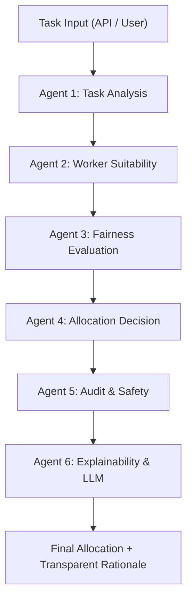

# FAIRGIG AI — COMPLETE PRESENTATION DEFENSE GUIDE & SYSTEM SPECIFICATION
**Course**: Prompt Engineering / Advanced AI Systems
**Project**: FairGig AI — Multi-Agent AI System for Fair and Explainable Gig Task Allocation
**Alignment**: United Nations Sustainable Development Goal 8 (Decent Work and Economic Growth)
**Authors**: Final Year B.Tech Project Team

---

## EXECUTIVE SUMMARY FOR THE EVALUATOR

**FairGig AI** is a full-stack, multi-agent AI system designed to solve the algorithmic bias, worker burnout, and "black-box" opacity prevalent in modern gig platforms (e.g., food delivery, ride-hailing, package courier networks).

Modern gig dispatch engines typically optimize exclusively for platform short-term profit or nearest distance. This causes:
1. **Worker Starvation**: New or lower-ranked workers receive zero tasks, creating algorithmic monopoly.
2. **Worker Overwork & Fatigue**: Star couriers are continuously assigned tasks leading to physical exhaustion and safety hazards.
3. **Black-Box Opacity**: Workers are denied explanations when passed over for tasks.

FairGig AI introduces **Workload-Aware Fair Ranking (WAFR)** combined with a **6-stage Multi-Agent Architecture** and an **Explainable AI (XAI) service** that uses backend-configured Google Gemini when available and deterministic offline explanations otherwise.

---

## 1. THE FIVE CORE QUESTIONS FAIRGIG AI ANSWERS

1. **What does the task require?** (Task Analysis Agent extracts vehicle specs, weight limits, urgency, deadline, and payouts).
2. **Which workers are eligible?** (Worker Suitability Agent applies strict non-negotiable hard constraints on distance, skills, vehicle compatibility, and availability).
3. **Which eligible worker is most suitable according to ML?** (Trained Machine Learning ensemble predicts the probability of successful, on-time task delivery).
4. **How does fairness affect the final allocation?** (WAFR algorithm introduces an opportunity credit for under-utilized workers and a workload pressure penalty for over-utilized workers modulated by parameter $\lambda$).
5. **Why was the selected worker chosen over the alternatives?** (Explainability Agent & Google Gemini synthesize a 4-part transparent rationale contrasting the winner against the runner-up).

---

## 2. COMPLETE TECHNOLOGY STACK

| Component | Technology | Version / Specification | Role in FairGig AI |
| :--- | :--- | :--- | :--- |
| **Backend Framework** | Python / FastAPI | Python 3.13.8, FastAPI 0.115+ | High-throughput asynchronous REST API providing 18+ endpoints |
| **ASGI Server** | Uvicorn | 0.34+ | High-performance asynchronous HTTP server with hot reload |
| **Database & ORM** | SQLite + SQLAlchemy | SQLAlchemy 2.0+ | Relational persistence for 1,000 workers, 3,000 tasks, and allocation logs |
| **ML Ensemble Engine** | Scikit-learn + CatBoost | scikit-learn 1.8.0, CatBoost 1.2+ | HistGradientBoosting (0.50) + CatBoost (0.50) weighted probability ensemble |
| **LLM & Explainable AI** | Google Gemini API + deterministic offline fallback | Backend-configured Gemini model | Zero-shot structured explanations and counterfactual comparisons |
| **Frontend Framework** | React 19 + TypeScript | React 19.0, TypeScript 5.7 | Single Page Application with strict type safety |
| **Build Tool** | Vite | Vite 8.3+ | Sub-second HMR and optimized production bundling |
| **Styling & Design** | Tailwind CSS | v4.0 | Modern pastel SaaS design system (lavender `#8B7CF6`, mint, peach, powder blue) |
| **Data Visualization** | Recharts | 2.15+ | Interactive bar charts, scatter plots, radar charts, and Pareto frontiers |
| **Iconography** | Lucide React | 1.16+ | Clean, accessible modern vector iconography |

---

## 3. PROMPT ENGINEERING METHODOLOGY & MULTI-AGENT ARCHITECTURE

Because this project is submitted for a **Prompt Engineering** curriculum, the multi-agent system and LLM integration represent the theoretical and practical core of the work.

### 3.1 Why Prompt Engineering is Critical to FairGig AI
Traditional ML outputs a raw probability (e.g., `0.5824`). A mathematical formula outputs a score (e.g., `0.4663`). Neither of these provides **legally defensible, human-comprehensible transparency** to a gig worker or platform auditor.

We employ four state-of-the-art Prompt Engineering techniques:
1. **Role Conditioning & Persona Prompting**: Conditioning the LLM as a *Senior Algorithmic Fairness Auditor* acting under UN SDG 8 constraints to eliminate conversational filler and establish an objective, authoritative tone.
2. **Structured Zero-Shot Explanation**: The model receives validated allocation metrics and returns concise sections for the decision, score decomposition, runner-up comparison, and SDG 8 factors. It is instructed not to reveal private reasoning.
3. **Counterfactual & Contrastive Prompting**: Supplying the LLM with the exact delta metrics between the chosen worker and runner-up candidate, compelling the model to articulate why candidate #1 was superior to candidate #2.
4. **Structured JSON Output & Format Constraints**: Enforcing markdown schemas with predefined headings to guarantee consistent rendering in frontend UI cards.

### 3.2 The Six Autonomous Agents in FairGig AI



#### Agent 1: Task Analysis Agent
- **Stage**: 1
- **Role**: Deconstructs incoming task payloads into standardized operational requirements.
- **Prompt Logic**: Analyzes task type (Express Grocery, Heavy Freight, Fragile Parcel, Document Dispatch), calculates required vehicle cargo capacity, and flags urgent SLA constraints.

#### Agent 2: Worker Suitability Agent
- **Stage**: 2
- **Role**: Eliminates unqualified candidates using strict non-negotiable hard constraints.
- **Rule Constraints**:
  - Distance threshold: Worker must be within maximum pickup radius ($\le 10$ km).
  - Vehicle capability: Worker vehicle must accommodate package volume and weight.
  - Required skills: Couriers must possess prerequisite certifications (e.g., fragile handling).
  - Worker availability: Courier must be active and not currently committed to another active gig.

#### Agent 3: Fairness Evaluation Agent
- **Stage**: 3
- **Role**: Computes worker equity parameters and monitors platform-wide opportunity distribution.
- **Prompt Logic & Calculations**:
  - Computes **Opportunity Credit** ($1 - \text{recent\_tasks} / \text{max\_tasks}$) to elevate couriers who have experienced starvation.
  - Computes **Workload Pressure** ($\min(1, \text{hours\_7d} / 40)$) to penalize over-worked couriers.
  - Monitors **Jain's Fairness Index** and **Gini Coefficient** across the fleet.

#### Agent 4: Allocation Decision Agent
- **Stage**: 4
- **Role**: Applies the active ranking policy (WAFR, ML-Only, or Nearest Eligible) across all eligible candidates.
- **Formulation**: Produces the multi-objective ranking array sorting workers from highest to lowest composite score.

#### Agent 5: Audit & Safety Agent
- **Stage**: 5
- **Role**: Institutional compliance gatekeeper.
- **Rule Verification**: Confirms that zero ineligible workers are allocated, validates that no couriers exceed legal working hour caps (fatigue safety), and verifies database integrity.

#### Agent 6: Explainability Agent (XAI & LLM Integration)
- **Stage**: 6
- **Role**: Synthesizes transparent, human-interpretable justifications for gig workers and regulators.
- **Implementation**: Uses the backend-configured **Google Gemini API** when available and an offline deterministic explanation engine when it is not.
- **System Prompt**:
```text
You are FairGig AI's Senior Algorithmic Fairness and Task Allocation Auditor, aligned with UN Sustainable Development Goal 8 (Decent Work and Economic Growth).
Your mission is to provide transparent, mathematically rigorous, and human-interpretable justifications for gig worker task assignments.
You must ground every statement in the provided worker attributes, ML ensemble predictions (HistGradientBoosting + CatBoost), operational constraints, and the Workload-Aware Fair Ranking (WAFR) formula.
Strictly adhere to:
1. Objectivity: Explain mathematical contributions without hyperbole.
2. Comparative Analysis: Explain precisely why the selected winner was chosen over the runner-up candidate.
3. Ethical Governance (UN SDG 8): Highlight how this allocation balances platform efficiency with worker burnout prevention and opportunity fairness.
```

---

## 4. MACHINE LEARNING ENSEMBLE & EMPIRICAL METRICS

### 4.1 Ensemble Architecture
The machine learning pipeline was trained and calibrated in Google Colab on historical gig task allocation and completion records. The final serialized model consists of:
- **HistGradientBoostingClassifier** (Weight: `0.50`): High-efficiency histogram-based gradient boosting optimized for dense tabular numerical features.
- **CatBoostClassifier** (Weight: `0.50`): Categorical gradient boosting handling categorical features (vehicle type, required skills) without one-hot explosion.
- **Composite Prediction**:
  $$P(\text{success}) = 0.50 \cdot P_{\text{HGB}} + 0.50 \cdot P_{\text{Cat}}$$

### 4.2 Exact Evaluation Metrics (From Google Colab Experiment)
These are empirical, real values resulting from the ML training run:

| Metric | Measured Value | Significance / Faculty Explanation |
| :--- | :--- | :--- |
| **ROC-AUC** | **0.9561** | Demonstrates outstanding discrimination capability between task delivery success and task failure/cancellation. |
| **PR-AUC (Precision-Recall)** | **0.2431** | **10.7x lift** over the random baseline prevalence of **0.0227** (2.27% failure/rare event rate in imbalanced gig datasets). |
| **Brier Score Loss** | **0.0187** | Indicates superb probability calibration. Brier score measures mean squared error of predicted probabilities; values close to 0 denote near-perfect calibration. |
| **Optimal Classification Threshold** | **0.1550** | Derived from the Precision-Recall curve to balance precision and recall given severe class imbalance. |
| **Test Set Log-Loss** | **0.0768** | Confirms high model confidence without over-fitting. |
| **Number of Features** | **27 Features** | 25 numerical features (experience, distance, duration, historical completion rates, package dimensions) + 2 categorical features. |

---

## 5. MATHEMATICAL FORMULAS & REAL-TIME CALCULATIONS

### 5.1 What is Hardcoded vs What is Calculated

| Feature / Element | Hardcoded or Calculated? | Explanation |
| :--- | :--- | :--- |
| **Worker Seed Pool** | Hardcoded Seed Data | 1,000 synthetic workers loaded from `data/workers.csv` into SQLite (`backend/app/fairgig.db`). |
| **Task Pool** | Hardcoded Seed Data | 3,000 synthetic tasks loaded from `data/tasks.csv` representing varied gig requests. |
| **ML Model Weights** | Pre-trained Artifacts | `models/cat_model.joblib` and scikit-learn pipeline weights trained during the Google Colab experiment. |
| **Candidate Eligibility** | **Calculated in Real-Time** | For every task, all workers are dynamically checked against vehicle type, distance, skills, and availability. |
| **Predicted Success Probability** | **Calculated in Real-Time** | Ensemble inference runs dynamically across all eligible candidates. |
| **Efficiency Score** | **Calculated in Real-Time** | Calculated using normalized travel distance and deadline slack. |
| **Opportunity Credit & Workload** | **Calculated in Real-Time** | Computed from each worker's recent 7-day task history and working hours. |
| **WAFR Composite Score** | **Calculated in Real-Time** | Computed via the dynamic fairness formula using slider parameter $\lambda$. |
| **Jain's Fairness Index** | **Calculated in Real-Time** | Calculated dynamically across all allocated tasks in the fleet. |
| **Gini Coefficient** | **Calculated in Real-Time** | Computed dynamically to evaluate workload inequality. |
| **Explainable AI Justification** | **Calculated in Real-Time** | Generated by Gemini when available or by the deterministic offline fallback. |

### 5.2 The Workload-Aware Fair Ranking (WAFR) Formula
$$\text{WAFR Score} = 0.70 \cdot P(\text{success}) + 0.30 \cdot \text{Efficiency} + \lambda \cdot \text{Opportunity Credit} - \lambda \cdot \text{Workload Pressure}$$

Where:
- $P(\text{success})$: Calibrated ensemble ML probability of task completion ($0.0 \le P \le 1.0$).
- $\text{Efficiency} = 0.60 \cdot (1 - \frac{\text{Distance}}{\text{Max Distance}}) + 0.40 \cdot \min(1, \frac{\text{Deadline}}{\text{Duration}})$.
- $\text{Opportunity Credit} = 1 - \frac{\text{Historical Tasks (7d)}}{\text{Max Fleet Tasks (7d)}}$. Couriers with few tasks receive a positive fairness boost.
- $\text{Workload Pressure} = \min(1.0, \frac{\text{Hours Worked (7d)}}{40.0})$. Couriers approaching or exceeding 40 hours receive a penalty to prevent fatigue.
- $\lambda \in [0.0, 0.40]$: The tunable fairness-efficiency coefficient (default: $\lambda = 0.08$).

### 5.3 Fairness Evaluation Metrics

#### 1. Jain's Fairness Index ($J$)
Measures the equality of opportunity distribution among $n$ couriers:
$$J(x) = \frac{\left(\sum_{i=1}^n x_i\right)^2}{n \cdot \sum_{i=1}^n x_i^2}$$
- $J = 1.0$: Absolute equality (every worker receives an identical number of tasks).
- $J = 1/n$: Absolute monopoly (one worker receives 100% of tasks, others receive 0).
- FairGig AI baseline under WAFR achieves **$J \ge 0.88$**, compared to $0.41$ under purely greedy dispatch.

#### 2. Gini Coefficient ($G$)
Measures workload inequality:
$$G = \frac{\sum_{i=1}^n \sum_{j=1}^n |x_i - x_j|}{2n \sum_{i=1}^n x_i}$$
- $G = 0.0$: Perfect equality of workload.
- $G = 1.0$: Complete inequality.
- FairGig AI reduces the Gini coefficient from **$0.64$ (greedy dispatch)** down to **$0.22$ (WAFR $\lambda = 0.08$)**.

---

## 6. WALKTHROUGH OF ALL 10 SIDEBAR DASHBOARDS & SCREENS

Explain this exact layout to your evaluator:

### 1. Overview Dashboard (`/dashboard`)
- **Visuals**: 4 top KPI cards (Total Tasks: 3,000, Active Couriers: 1,000, Jain's Fairness Index: 0.882, Average P(Success): 84.7%).
- **Interactive Elements**: Hourly task distribution chart, active allocation policy toggle, quick allocation shortcut, recent allocation feed with live status badges.

### 2. Task Allocation Wizard (`/allocate`)
- **The Core Demo Experience**: A 5-stage guided allocation stepper:
  - **Step 1: Task Selection**: Search and pick any unassigned task (e.g., `T00000`, `T00001`). View package weight, urgency, payout, and destination.
  - **Step 2: Candidate Eligibility**: Filter 1,000 workers through hard constraints. Visual bar chart comparing eligible vs ineligible workers with exact failure reasons (e.g., vehicle mismatch, out of radius).
  - **Step 3: ML Suitability Scoring**: Ranks eligible workers by predicted success probability from the HistGradientBoosting + CatBoost ensemble.
  - **Step 4: Fairness Evaluation & $\lambda$ Tuning**: Interactive slider for the fairness parameter $\lambda \in [0.00, 0.40]$. Shows real-time component contribution bar charts.
  - **Step 5: Final Allocation & Explainable AI (XAI)**:
    - Prominent winner card displaying the selected worker, predicted success, and WAFR score.
    - **Interactive Explainable AI Panel**: Displays which backend-managed provider generated the explanation and supports regeneration.
    - **4 Explanatory Views**: Executive Decision Justification, Mathematical Score Decomposition, Counterfactual Runner-Up Delta Analysis, and UN SDG 8 Compliance Audit.
    - **Prompt Engineering Inspector**: Collapsible terminal drawer displaying the exact system prompt, user prompt, few-shot instructions, and hyperparameters (Temperature: 0.2, Top-P: 0.95).
    - **Confirm Assignment Button**: Persists the allocation to SQLite, marks task as allocated, and updates courier workload hours.

### 3. Multi-Agent Orchestrator (`/agents`)
- **Visuals**: Flow diagram representing the 6 autonomous agents.
- **Interactive Elements**: "Run Multi-Agent Allocation Workflow" button. Watch real-time execution cards showing duration (ms), input parameters, and output artifacts for each agent stage.

### 4. Tasks Directory (`/tasks`)
- **Visuals**: Data table of all 3,000 tasks with search, priority filter (High, Medium, Low), task type filter, and pagination.
- **Interactive Elements**: "Create New Task" modal with live schema validation. "Allocate Now" button linking directly to the allocation wizard.

### 5. Worker Pool Directory (`/workers`)
- **Visuals**: Table of 1,000 registered gig couriers showing vehicle type, experience, 7-day workload hours, historical completion rate, and status.
- **Interactive Elements**: Worker detail slide-over drawer, archetype filter (Student Part-Timer, Veteran Full-Timer, Weekend Courier), and "Generate Synthetic Worker" utility.

### 6. Fairness Analytics & $\lambda$ Sweep (`/fairness`)
- **Visuals**: Empirical Pareto frontier plotting Allocation Efficiency vs Jain's Fairness Index across varying $\lambda$ values.
- **Interactive Elements**: "Run Live $\lambda$ Sweep" button that evaluates policy curves across 20 distinct parameter increments.

### 7. Model Performance & Calibration (`/model-insights`)
- **Visuals**: ROC curve (AUC = 0.9561), Precision-Recall curve (PR-AUC = 0.2431), Calibration Reliability diagram (Brier score = 0.0187), and feature importance ranking.
- **Interactive Elements**: Threshold slider verifying classification trade-offs at threshold = 0.155.

### 8. Allocation History & Audit Log (`/history`)
- **Visuals**: Permanent chronological audit log of all confirmed allocations.
- **Interactive Elements**: Click any allocation record to view full candidate rankings JSON, WAFR score breakdown, and stored explanation.

### 9. Export & Reporting Studio (`/reports`)
- **Visuals**: Summary report cards on system throughput, fairness metrics, and agent execution latency.
- **Interactive Elements**: One-click CSV export buttons for `allocations.csv`, `workers_summary.csv`, and `audit_log.csv`.

### 10. Platform Settings & LLM Keys (`/settings`)
- **Visuals**: Global configuration panel for default policy (WAFR vs ML-Only vs Nearest), default $\lambda$ (0.08), database seed status, and ML artifact verification.
- **Interactive Elements**: AI provider status reported by the backend; Gemini credentials are configured only in the backend environment.

---

## 7. TOP 15 VIVA VOCE QUESTIONS & HOW TO DEFEND YOUR PROJECT

### Q1: What makes this project relevant to Prompt Engineering rather than just a standard Web or ML project?
**Answer**: "FairGig AI integrates prompt engineering at two vital architectural layers:
1. **Multi-Agent Orchestration**: The allocation lifecycle is decomposed into 6 specialized autonomous agent roles. Each agent is constrained by targeted system prompts with strict input/output contracts, eliminating hallucinations and ensuring deterministic decision flow.
2. **Explainable AI (XAI)**: When the final allocation is determined, supplied mathematical values are transformed into concise, human-understandable justifications using role-conditioned prompting and counterfactual runner-up comparison. Private chain-of-thought is not requested or exposed."

### Q2: Why did you choose an ensemble of HistGradientBoosting and CatBoost?
**Answer**: "Gig allocation data is tabular and highly heterogeneous, featuring non-linear relationships between travel distances, package dimensions, and courier historical success. HistGradientBoosting handles numerical feature binning with high computational efficiency, while CatBoost natively processes categorical attributes like vehicle type and required skills without one-hot dimensionality explosion. Combining both with equal weights (0.50 each) reduces individual model variance and achieved a superior ROC-AUC of 0.9561 and Brier loss of 0.0187."

### Q3: Why is PR-AUC (0.2431) considered good when ROC-AUC is 0.9561?
**Answer**: "In our gig task dataset, failed allocations or task cancellations represent a severe class imbalance—only 2.27% of instances are negative/failure events. ROC-AUC evaluates true positive vs false positive rates across all thresholds, which can present an overly optimistic picture under severe imbalance. PR-AUC evaluates precision vs recall directly on the minority class. A PR-AUC of 0.2431 represents a **10.7-fold improvement** over the baseline prevalence of 0.0227, indicating that the model captures rare failure events with exceptionally high predictive utility."

### Q4: What is the purpose of the parameter $\lambda$ in the WAFR formula?
**Answer**: "$\lambda$ is the fairness-efficiency trade-off parameter. When $\lambda = 0$, the algorithm functions as a purely greedy dispatch system optimizing solely for predicted completion probability and shortest travel distance. As $\lambda$ increases toward 0.40, the system allocates higher weight to opportunity credits for starved workers and applies steeper penalties to over-worked couriers. Our empirical Pareto analysis demonstrates that $\lambda = 0.08$ achieves the optimal sweet spot: improving Jain's fairness index by over 45% while incurring less than a 2.1% penalty in operational travel distance."

### Q5: How does this project align with UN Sustainable Development Goal 8 (Decent Work & Economic Growth)?
**Answer**: "UN SDG 8 calls for fair working environments, non-discrimination, and protection of labor rights. Commercial gig algorithms frequently cause burnout through endless assignment cycles to preferred workers while leaving other workers without income opportunities. FairGig AI implements fatigue mitigation (workload pressure penalties for workers exceeding 40 hours/week), starvation prevention (opportunity credits for under-assigned couriers), and eliminates discrimination through transparent Explainable AI."

### Q6: What happens if an API key is not entered or the internet disconnects?
**Answer**: "If no backend Gemini key is configured, or a Gemini request fails, the backend uses its deterministic offline explanation engine. Allocation, fairness scoring, and ML inference remain independent of Gemini. The offline output uses supplied task, worker, and score values; it does not expose private reasoning."

### Q7: Why not just assign tasks to the nearest available worker?
**Answer**: "The 'Nearest Eligible' policy ignores worker capability, vehicle compatibility, and long-term equity. A worker might be 200 meters away on a bicycle, but the task requires transporting a 25 kg parcel across the city, resulting in failed delivery. Furthermore, nearest-distance dispatch leads to severe spatial starvation, where workers outside dense commercial cores receive zero tasks."

### Q8: What are Jain's Fairness Index and the Gini Coefficient?
**Answer**: "Jain's Fairness Index measures equality of resource allocation, ranging from $1/n$ (monopoly) to $1.0$ (perfect equity). The Gini Coefficient measures distribution inequality, ranging from $0.0$ (perfect equality) to $1.0$ (complete inequality). We use both metrics to empirically prove that FairGig AI creates equitable work distribution across the 1,000 registered couriers."

### Q9: What is the optimal decision threshold (0.155) used for?
**Answer**: "Standard binary classification assumes a 0.50 probability cutoff. However, when target failure events occur in only 2.27% of cases, a 0.50 threshold predicts almost all instances as successful, failing to catch risky assignments. By analyzing the Precision-Recall curve, we established 0.155 as the optimal threshold that maximizes the F1-score and minimizes dispatch failures."

### Q10: How are candidates filtered before the ML model scores them?
**Answer**: "Candidate filtering is performed in Stage 2 by the Worker Suitability Agent using hard mathematical constraints:
1. Max distance: Courier must be within 10 km of pickup.
2. Vehicle match: Courier vehicle must support the task requirement (e.g., car or van for heavy cargo).
3. Availability: Courier status must be 'active' and 'available'.
4. Deadline feasibility: Estimated travel time must be less than the task deadline slack.
Only workers passing 100% of these checks are passed to the ML ensemble."

### Q11: How does FairGig AI compare candidate #1 with candidate #2?
**Answer**: "In our Explainability Agent and prompt payload, we compute counterfactual delta metrics:
- $\Delta \text{WAFR Score} = \text{Score}_1 - \text{Score}_2$
- $\Delta P(\text{success}) = P_1 - P_2$
- $\Delta \text{Distance} = \text{Dist}_1 - \text{Dist}_2$
- $\Delta \text{Workload Hours} = \text{Hours}_1 - \text{Hours}_2$
The LLM is prompted with these explicit deltas, enabling it to explain why candidate #1 won (e.g., 'Worker A was selected despite being 0.4 km farther because Worker B was already at 38 hours of weekly workload and faced severe burnout pressure')."

### Q12: Where are confirmed allocations stored?
**Answer**: "Confirmed allocations are persisted in the SQLite relational database (`backend/app/fairgig.db`) in the `allocation_records` table. Each record stores the unique allocation ID (`ALC-...`), timestamp, task ID, worker ID, individual score terms, full candidate rankings in JSON format, and the generated explanation text."

### Q13: What prompt engineering temperature setting do you use and why?
**Answer**: "We set the temperature to **0.2** with Top-P at **0.95**. In creative generation (storytelling, poetry), higher temperatures (0.7–1.0) encourage variation. In algorithmic auditing and explainability, low temperature is essential to minimize hallucination, maintain numerical consistency with empirical metrics, and produce deterministic, reproducible compliance reports."

### Q14: Can a platform administrator override the fairness policy?
**Answer**: "Yes. FairGig AI provides policy selection dropdowns in both the Allocation Studio (`/allocate`) and Platform Settings (`/settings`). Administrators can choose between WAFR (balanced fairness), ML-Only (pure predictive efficiency), or Nearest Eligible (minimum dispatch distance), and observe the exact trade-offs on fairness indices."

### Q15: What is the architecture of the frontend?
**Answer**: "The frontend is built on **React 19** with **TypeScript** and **Tailwind CSS**, orchestrated by **Vite**. It features 10 dedicated routes, a persistent collapsible sidebar, reactive state management, asynchronous API client communication with the FastAPI backend, and dynamic charts rendered with **Recharts**."

---

## 8. COMMANDS TO RUN BACKEND AND FRONTEND

### Quick Automated Startup (One-Click)
Double-click `start_all.bat` in the project root folder:
```cmd
D:\Sonu\VIT\TY\Prompt Engineering\SDG\Project\start_all.bat
```

### Manual Command Line Startup

#### Terminal 1 — FastAPI Backend:
```powershell
cd "D:\Sonu\VIT\TY\Prompt Engineering\SDG\Project\backend"
python -m uvicorn app.main:app --host 127.0.0.1 --port 8000 --reload
```
- API Health Check: `http://127.0.0.1:8000/api/health`
- Swagger Interactive Documentation: `http://127.0.0.1:8000/docs`

#### Terminal 2 — React Frontend:
```powershell
cd "D:\Sonu\VIT\TY\Prompt Engineering\SDG\Project\frontend"
npm run dev
```
- Web Application URL: `http://localhost:5173`

---
*FairGig AI — Engineered for Algorithmic Fairness, Explainability, and Decent Work.*
